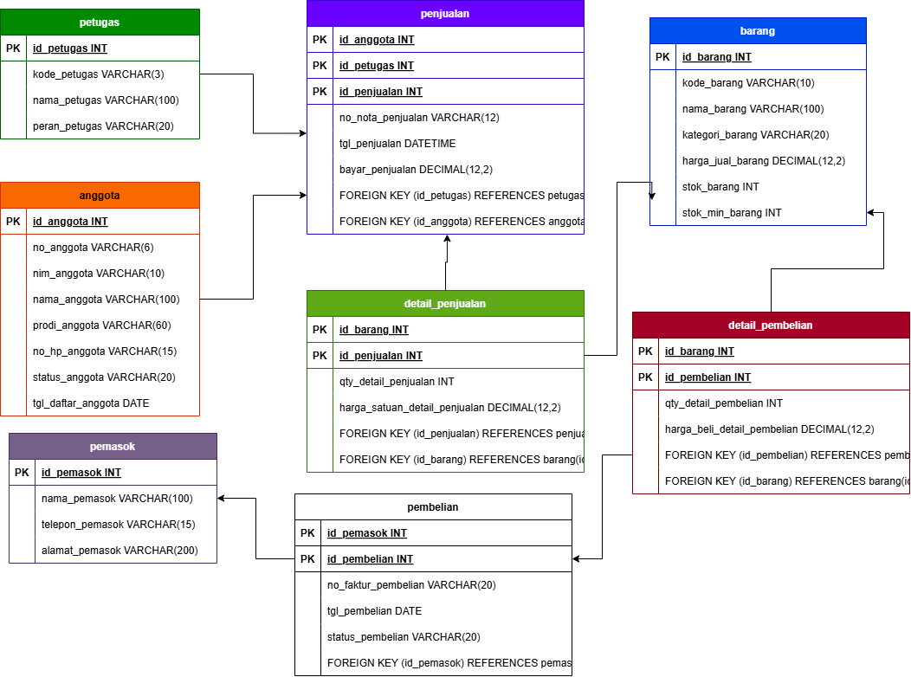

# Laporan Praktikum Basis Data - Pertemuan 3
**Nama:** Abim Faturohman  

**NIM:** 25430107  

**Kelas:** D   

**Tanggal** : 14 oktober 2026

**Dosen Pengampu** : Dedi Irawan, S.Kom., M.Kom. 

## 1. Tujuan Praktikum
1. Mengidentifikasi entitas, atribut, dan kunci dari dokumen kebutuhan data.
2. Menentukan relasi beserta kardinalitas dan partisipasinya berdasarkan aturan bisnis.
3. Memecah relasi banyak-ke-banyak (M:N) menjadi entitas asosiatif.
4. Menggambar ERD notasi Crow's Foot dan memvalidasinya terhadap kebutuhan informasi (KI).

## 2. Ringkasan Dasar Teori
Model Entity-Relationship (ERD) menggambarkan struktur konseptual basis data dalam bentuk entitas, atribut, dan relasi. Kardinalitas menentukan jumlah maksimum pasangan entitas, sedangkan partisipasi menentukan apakah hubungan bersifat wajib (mandatory) atau opsional. Notasi Crow's Foot menggunakan simbol garis, lingkaran (0), dan cakar ayam (N) untuk merepresentasikan kardinalitas. Relasi banyak-ke-banyak (M:N) tidak dapat disimpan langsung dalam tabel relasional sehingga harus dipecah menggunakan entitas asosiatif yang memiliki atribut bawaan transaksi (seperti jumlah barang atau harga saat transaksi).

## 3. Hasil Langkah Percobaan
### 3.1 Pemodelan Diagram ERD Kopma
Diagram ERD konseptual untuk Koperasi Mahasiswa Sejahtera (Kopma) berhasil digambar menggunakan draw.io dengan notasi Crow's Foot.

### 3.2 Pemetaan Kardinalitas Relasi Kopma
* **petugas melayani penjualan:** Tepat satu petugas melayani nol atau banyak penjualan (1 : 0..N).
* **anggota melakukan penjualan:** Nol atau satu anggota melakukan nol atau banyak penjualan (0..1 : 0..N) karena pembeli umum diizinkan tanpa kartu anggota (AB-02).
* **penjualan berisi detail_penjualan:** Tepat satu penjualan memiliki satu atau banyak detail penjualan (1 : 1..N) berdasarkan aturan AB-01.
* **barang tercantum di detail_penjualan:** Tepat satu barang dapat tercantum di nol atau banyak detail penjualan (1 : 0..N).

## 4. Jawaban Titik Analisis
* **Titik Analisis 1:** `id_anggota` digunakan sebagai kunci primer pengganti (*surrogate key*) bertipe integer otomatis untuk meningkatkan efisiensi indeks relasional dan menghindari pengubahan kunci tamu jika ada perubahan data alami. Risiko jika `nim_anggota` dijadikan kunci primer adalah jika mahasiswa mengalami perubahan NIM (misalnya perpindahan program studi atau koreksi administrasi), maka perubahan tersebut akan memicu pemutakhiran berantai (*cascade update*) pada seluruh tabel transaksi terkait.
* **Titik Analisis 2:** Aturan bisnis yang memaksanya adalah AB-01 (Setiap nota memiliki nomor unik dan minimal satu baris barang). Aturan "minimal satu" ini tidak dapat dijaga oleh struktur constraint tabel DDL biasa saja, melainkan harus dijaga oleh logika transaksi bisnis (*transaction management*) saat pengisian data (dibahas pada Modul 14).
* **Titik Analisis 3:** ERD saat ini belum dapat menjawab pertanyaan tersebut secara langsung karena belum ada relasi antara petugas gudang dengan tabel `pembelian`. Untuk memenuhinya, perlu ditambahkan kunci tamu `id_petugas` pada tabel `pembelian` dan dicatat sebagai aturan bisnis baru (misal: "Setiap transaksi penerimaan barang wajib mencatat petugas gudang yang menerima").

## 5. Hasil Latihan dan Modifikasi
1. **Atribut Poin Loyalitas:** Poin loyalitas cukup dijadikan atribut `poin_anggota` pada entitas `anggota` jika organisasi hanya membutuhkan saldo poin saat ini. Namun, jika organisasi membutuhkan riwayat penerimaan dan penukaran poin secara transparan, perlu dibuat entitas baru `riwayat_poin` yang terhubung ke `anggota`.
2. **Dampak Relasi M:N Langsung:** Jika relasi `penjualan` dan `barang` dihubungkan secara M:N langsung tanpa entitas asosiatif `detail_penjualan`, maka data atribut transaksi seperti `qty_detail_penjualan` dan `harga_satuan_detail_penjualan` (harga historis saat transaksi, AB-04) akan hilang dan tidak dapat disimpan.

## 6. Tugas Mandiri: Milestone Proyek 3
### 6.1 Diagram ERD Proyek Perpustakaan (`perpus_107`)
ERD proyek perpustakaan dirancang menggunakan notasi Crow's Foot dan dilengkapi entitas asosiatif `detail_peminjaman`.

### 6.2 Tabel Relasi dan Kardinalitas Proyek Perpustakaan
| Relasi | Sisi Kiri | Sisi Kanan | Dasar Aturan Bisnis |
| :--- | :--- | :--- | :--- |
| `petugas` melayani `peminjaman` | Tepat 1 petugas | 0 atau banyak peminjaman | AB-01 (Petugas mencatat transaksi) |
| `anggota` melakukan `peminjaman` | Tepat 1 anggota | 0 atau banyak peminjaman | AB-02 (Peminjam wajib anggota aktif) |
| `peminjaman` berisi `detail_peminjaman` | Tepat 1 peminjaman | 1 atau banyak detail | AB-03 (Satu transaksi memuat min. 1 buku) |
| `buku` tercantum di `detail_peminjaman` | Tepat 1 buku | 0 atau banyak detail | AB-04 (Buku dapat dipinjam berkali-kali) |

### 6.3 Penelusuran Kebutuhan Informasi (KI) ke Jalur ERD
* **KI-01 (Daftar peminjaman aktif per anggota):** `anggota` $\rightarrow$ `peminjaman`
* **KI-02 (Buku paling sering dipinjam):** `buku` $\rightarrow$ `detail_peminjaman` $\rightarrow$ `peminjaman`
* **KI-03 (Total denda per transaksi):** `peminjaman` $\rightarrow$ `detail_peminjaman`
* **KI-04 (Riwayat transaksi petugas):** `petugas` $\rightarrow$ `peminjaman`

### 6.4 Catatan Tinjauan Klien (Umpan Balik Teman Sekelas)
1. **Umpan Balik 1:** "Tambahkan atribut tanggal kembali riil pada detail peminjaman untuk menghitung keterlambatan per buku."
   * **Keputusan:** Diterima. Atribut `tgl_kembali_aktual` ditambahkan pada `detail_peminjaman`.
2. **Umpan Balik 2:** "Status anggota sebaiknya dipisah menjadi entitas tersendiri."
   * **Keputusan:** Ditolak. Status cukup menggunakan tipe data ENUM ('aktif', 'nonaktif') pada entitas `anggota` karena nilainya bernilai tetap dan sederhana.

## 7. Pembahasan dan Kendala
* **Kendala 1:** Menentukan bentuk relasi antara tabel `peminjaman` dan `buku`.
  * **Solusi:** Karena satu peminjaman dapat memuat banyak buku dan satu buku dapat dipinjam dalam banyak peminjaman, dibuat entitas asosiatif `detail_peminjaman` dengan kunci komposit (`id_peminjaman`, `id_buku`).
* **Kendala 2:** Mengatur garis relasi di draw.io agar tidak saling berpotongan dan mudah dibaca.
  * **Solusi:** Menyusun tata letak entitas utama di tengah dan entitas asosiatif di antaranya, serta memberi label Crow's Foot yang jelas pada ujung garis.

## 8. Kesimpulan
Model konseptual ERD berhasil dirancang menggunakan notasi Crow's Foot untuk kasus Kopma dan proyek perpustakaan `perpus_107`. Pemecahan relasi banyak-ke-banyak menjadi entitas asosiatif terbukti krusial untuk menyimpan atribut transaksi historis. Penelusuran kueri KI terhadap ERD memastikan seluruh kebutuhan informasi organisasi dapat terpenuhi.

## 9. Pernyataan Penggunaan AI
Asisten AI (Gemini) digunakan sebesar **±25%** dari total pekerjaan modul ini. AI dimanfaatkan khusus untuk membantu penyusunan draf kerangka laporan Markdown, memberikan masukan analisis penelusuran jalur KI pada ERD, dan memverifikasi penalaran Titik Analisis. Seluruh proses pembuatan diagram di draw.io, penentuan atribut proyek, dan pengambilan screenshot beridentitas dilakukan secara mandiri oleh praktikan.

## 10. Bukti Git
* **Tautan Repositori:** `https://github.com/Abimfath/basisdata-25430107`
* **Hash Commit Pertemuan 3:** `[5d61193]`
* **Pesan Commit:** `p03: pemodelan erd kopma dan proyek perpustakaan`

## Checklist
- [x] Identitas (Nama, NIM, Kelas, Pertemuan 3, Tanggal)
- [x] Tujuan Praktikum ditulis ulang dengan bahasa sendiri
- [x] Ringkasan dasar teori pemahaman sendiri (maksimal setengah halaman)
- [x] Tangkapan layar ERD di draw.io dengan kardinalitas terbaca
- [x] Jawaban Titik Analisis 1-3 dijawab lengkap dengan alasan
- [x] Hasil Latihan E (penjelasan poin loyalitas dan relasi M:N)
- [x] Tugas Mandiri Milestone Proyek 3 (ERD `perpus_107`, tabel relasi, penelusuran KI, tinjauan klien)
- [x] Pembahasan dan kendala teknis yang dihadapi
- [x] Kesimpulan bahasa sendiri
- [x] Pernyataan Penggunaan AI (tercantum porsi 25%)
- [x] Bukti Git (Tautan repositori dan hash commit)