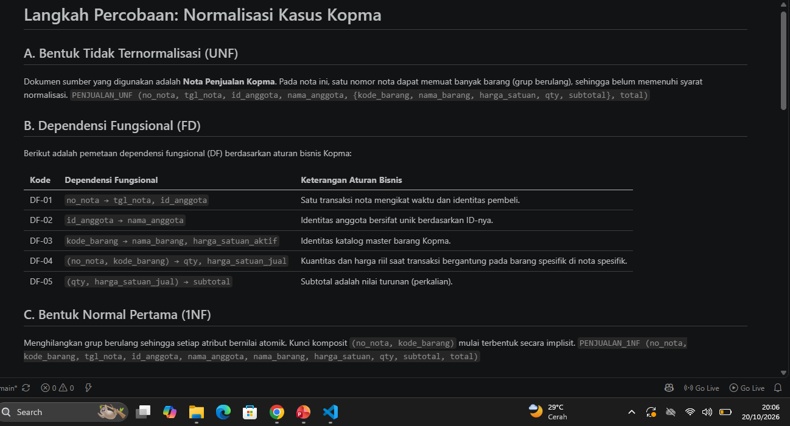
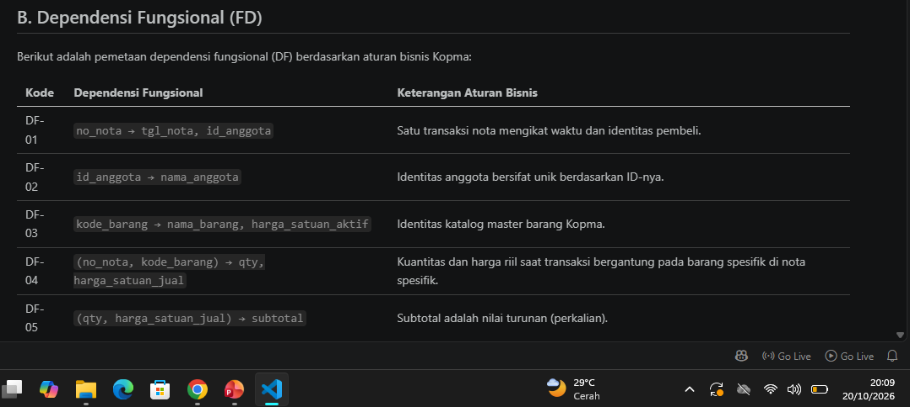
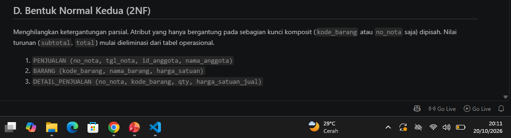
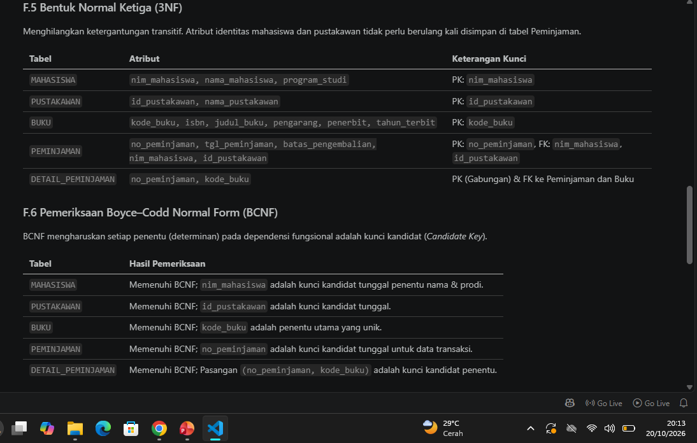

# Laporan Praktikum Basis Data - Pertemuan 04

**Nama:** Abim Faturohman  

**NIM:** 25430107  

**Kelas:** D   

**Tanggal** : 6 oktober 2026

**Dosen Pengampu** : Dedi Irawan, S.Kom., M.Kom
---

## 1. Tujuan Praktikum

Tujuan pelaksanaan praktikum pada Pertemuan 4 adalah:

1. Mengidentifikasi masalah dan anomali (ubah, sisip, hapus) pada struktur data yang belum ternormalisasi (UNF).
2. Merumuskan dependensi fungsional yang bersumber langsung dari aturan bisnis instansi.
3. Melakukan dekomposisi tabel secara bertahap dari UNF menuju 1NF, 2NF, hingga 3NF.
4. Melakukan validasi rancangan akhir menggunakan parameter *Boyce-Codd Normal Form* (BCNF).
5. Menganalisis dan memutuskan strategi penyimpanan atribut yang berstatus sebagai nilai turunan (*derived attributes*).
6. Mengimplementasikan seluruh tahapan normalisasi pada studi kasus proyek mandiri (Sistem Informasi Perpustakaan Ilmu Komputer UM Metro).

## 2. Ringkasan Dasar Teori

Normalisasi merupakan metodologi sistematis dalam perancangan basis data relasional untuk mendekomposisi tabel. Tujuannya adalah meminimalisasi redundansi data dan mencegah terjadinya anomali saat melakukan manipulasi data (DML). 

### 2.1 Masalah pada Data yang Belum Ternormalisasi (Anomali)

| Jenis Anomali | Deskripsi dan Dampak |
|---|---|
| **Anomali Sisip** *(Insertion)* | Ketidakmampuan menambahkan data baru ke dalam tabel karena ketiadaan data pada atribut kunci lain yang digabung dalam tabel yang sama. |
| **Anomali Ubah** *(Update)* | Keharusan memperbarui banyak baris data sekaligus untuk satu perubahan fakta. Rentan menyebabkan inkonsistensi jika ada baris yang terlewat. |
| **Anomali Hapus** *(Deletion)* | Hilangnya informasi penting yang tidak berkaitan secara tidak sengaja ketika menghapus suatu baris data. |

### 2.2 Tahapan Normalisasi Basis Data

| Bentuk Normal | Syarat dan Karakteristik |
|---|---|
| **UNF** *(Unnormalized)* | Berupa data mentah (*flat-file*) yang masih mengandung kelompok atribut berulang (*repeating groups*) di dalam satu baris. |
| **1NF** *(First)* | Seluruh atribut bernilai atomik (tunggal). Tidak ada lagi grup berulang. |
| **2NF** *(Second)* | Memenuhi 1NF dan terbebas dari dependensi parsial (atribut non-kunci harus bergantung pada seluruh bagian *composite key*, bukan sebagian saja). |
| **3NF** *(Third)* | Memenuhi 2NF dan terbebas dari dependensi transitif (atribut non-kunci tidak boleh bergantung pada atribut non-kunci lainnya). |
| **BCNF** *(Boyce-Codd)* | Bentuk lebih ketat dari 3NF di mana setiap determinan (penentu) dalam dependensi fungsional wajib berstatus sebagai *Candidate Key*. |

## 3. Hasil Langkah Percobaan (Kasus Kopma)

Praktik terpandu menggunakan dokumen sumber berupa Nota Penjualan Koperasi Mahasiswa (Kopma).

### 3.1 Mengubah Data UNF menjadi 1NF
Tahap ini memisahkan baris-baris daftar barang yang dibeli agar setiap baris memiliki identitas yang tunggal dan atomik.

| Tahap | Analisis Pemecahan |
|---|---|
| **UNF** | Atribut `{kode_barang, nama_barang, harga_satuan, qty, subtotal}` terdeteksi sebagai grup berulang dalam satu nota. |
| **1NF** | Grup berulang dipecah menjadi baris-baris baru. Kunci komposit `(no_nota, kode_barang)` mulai terbentuk secara implisit. |

*(Catatan: Ganti gambar dengan screenshot tabel UNF-1NF dari VS Code Anda)*

### 3.2 Menentukan Dependensi Fungsional
Identifikasi penentu (determinan) berdasarkan aturan bisnis Kopma:

| Determinan (Penentu) | Atribut yang Ditentukan | Keterangan Aturan Bisnis |
|---|---|---|
| `no_nota` | `tgl_nota`, `id_anggota` | Satu transaksi nota mengikat waktu dan identitas pembeli. |
| `id_anggota` | `nama_anggota` | ID Anggota merujuk pada nama yang spesifik. |
| `kode_barang` | `nama_barang`, `harga_satuan_aktif` | Identitas katalog master barang Kopma. |
| `(no_nota, kode_barang)`| `qty`, `harga_satuan_jual` | Kuantitas dan harga riil bergantung pada barang spesifik di nota spesifik. |

*(Catatan: Ganti gambar dengan screenshot daftar FD Kopma dari VS Code Anda)*

### 3.3 Mengubah 1NF menjadi 2NF
Mengeliminasi ketergantungan parsial. Informasi yang hanya bergantung pada `kode_barang` atau `no_nota` dipisah.

| Tabel Hasil 2NF | Atribut yang Disimpan |
|---|---|
| `PENJUALAN` | `no_nota`, `tgl_nota`, `id_anggota`, `nama_anggota` |
| `BARANG` | `kode_barang`, `nama_barang`, `harga_satuan` |
| `DETAIL_PENJUALAN`| `no_nota`, `kode_barang`, `qty`, `harga_satuan_jual` |

### 3.4 Mengubah 2NF menjadi 3NF
Mengeliminasi ketergantungan transitif. Nama anggota yang sebelumnya 'menumpang' di tabel Penjualan kini dibuatkan tabel entitas sendiri.

| Tabel Hasil 3NF | Atribut dan Kunci |
|---|---|
| `PENJUALAN` | PK: `no_nota`, FK: `id_anggota`. Menyimpan *header* transaksi. |
| `DETAIL_PENJUALAN`| PK: `(no_nota, kode_barang)`. Menyimpan rincian transaksi. |
| `BARANG` | PK: `kode_barang`. Master data inventaris. |
| `ANGGOTA` | PK: `id_anggota`. Master data pembeli tetap. |

*(Catatan: Ganti gambar dengan screenshot tahapan 2NF-3NF Kopma)*

### 3.5 Mencocokkan dengan Skema Kanonik dan Memeriksa BCNF
Skema hasil 3NF divalidasi dengan struktur kanonik Kopma (8 tabel utama). Pada skema BCNF, dipastikan tidak ada determinan yang bukan *Candidate Key*. 

| Pengecekan Entitas | Status BCNF |
|---|---|
| `PENJUALAN` | Memenuhi (Karena `no_nota` adalah kunci kandidat tunggal) |
| `DETAIL_PENJUALAN`| Memenuhi (Pasangan `no_nota` dan `kode_barang` mutlak menjadi determinan unik) |
| `BARANG` & `ANGGOTA`| Memenuhi (Kode/ID masing-masing adalah penentu tunggal tak terbantahkan) |

### 3.6 Menentukan Nilai Turunan
Pengambilan keputusan terkait atribut hasil kalkulasi matematis:

| Atribut Kalkulasi | Keputusan | Analisis Risiko jika Disimpan |
|---|---|---|
| `subtotal` | Dihitung (Kueri) | Rentan anomali ubah jika kuantitas barang direvisi oleh kasir. |
| `total` | Dihitung (Kueri) | Melanggar 3NF; berisiko inkonsisten jika ada detail barang yang dibatalkan/dihapus dari nota. |

### 3.7 Menyimpan Hasil Normalisasi
Seluruh tahapan telah didokumentasikan di dalam berkas `p04_normalisasi_kopma_107.md` dan di-*commit* ke repositori Git dengan pesan `p04: normalisasi kopma`.

## 4. Jawaban Titik Analisis

### 4.1 Titik Analisis: Harga Satuan di Detail Penjualan
`harga_satuan` wajib diletakkan di tabel `detail_penjualan` untuk merekam *data historis*. Apabila Kopma mengubah harga barang di tabel master `barang` pada tahun depan, riwayat total belanja pada nota tahun ini tidak akan berubah (tetap valid) karena harga transaksinya sudah terkunci di tabel detail.

### 4.2 Titik Analisis: Nilai Turunan Total/Subtotal
Penyimpanan nilai turunan pada tabel operasional (transaksional aktif) dilarang karena memicu anomali ubah. Namun, pada *data warehouse* atau tabel arsip historis yang bersifat *read-only*, nilai turunan boleh disimpan untuk mempercepat performa *rendering* laporan agregasi.

### 4.3 Titik Analisis: Informasi Pemasok
Menyimpan informasi asal pemasok ke dalam tabel master `barang` akan memicu redundansi jika satu barang disuplai oleh vendor yang berbeda-beda. Oleh karena itu, Kopma menggunakan relasi terpisah melalui tabel `pembelian` dan `detail_pembelian` yang memiliki rujukan langsung ke `id_pemasok`.

## 5. Hasil Latihan dan Modifikasi

### 5.1 Modifikasi Nomor Telepon Pemasok Multivalued
Atribut nomor telepon yang berjumlah lebih dari satu untuk satu entitas pemasok melanggar aturan 1NF (nilai tidak atomik).

| Tindakan | Desain Relasi Baru |
|---|---|
| Dekomposisi Atribut | Tabel `PEMASOK_TELEPON` dibuat terpisah dengan atribut: `id_pemasok` (sebagai FK) dan `nomor_telepon`. |

### 5.2 Anomali Penyimpanan Nama Anggota pada Tabel Penjualan
Jika `nama_anggota` tidak dipisah ke 3NF dan tetap berada di tabel `PENJUALAN`, akan timbul *Update Anomaly*.

| Kondisi Sistem | Skema Dampak Kegagalan |
|---|---|
| Perubahan Nama Anggota | Jika anggota bernama "Abim" mengganti ejaan namanya menjadi "Abim Faturohman", kita harus mengeksekusi perintah `UPDATE` pada ratusan baris nota lama tempat nama Abim tercatat. Jika ada baris yang terlewat, data menjadi inkonsisten. |

## 6. Tugas Mandiri: Milestone Proyek 4

### 6.1 Objek Proyek
Proyek yang dikembangkan adalah **Sistem Informasi Perpustakaan Ilmu Komputer UM Metro**, dirancang khusus untuk memfasilitasi sirkulasi literatur akademik mahasiswa dan operasional pustakawan fakultas.

### 6.2 Data Awal dan Dependensi Fungsional
Titik awal dekomposisi menggunakan **Formulir Peminjaman Buku Perpustakaan**.

| Kode | Pemetaan Dependensi Fungsional | Dasar Aturan Bisnis Proyek |
|---|---|---|
| DF-01 | `nim_mahasiswa → nama_mahasiswa, program_studi` | Identitas mahasiswa aktif. |
| DF-02 | `kode_buku → isbn, judul_buku, pengarang, penerbit, tahun_terbit` | Master data katalog perpustakaan kampus. |
| DF-03 | `id_pustakawan → nama_pustakawan` | Identitas pengelola perpustakaan. |
| DF-04 | `no_peminjaman → tgl_peminjaman, batas_pengembalian, nim_mahasiswa, id_pustakawan` | Atribut *header* transaksi operasional sirkulasi. |
| DF-05 | `(no_peminjaman, kode_buku) → status_pengembalian` | Keterangan spesifik per item buku dalam satu resi. |

### 6.3 Hasil Relasi Proyek (Tahap 3NF & BCNF)
Struktur akhir setelah dilakukan eliminasi dependensi parsial dan transitif menghasilkan 5 tabel operasional utama.

| Nama Tabel | Deskripsi Fungsi Operasional |
|---|---|
| `MAHASISWA` | Menyimpan profil peminjam berdasar NIM |
| `PUSTAKAWAN` | Menyimpan profil petugas layanan |
| `BUKU` | Entri katalog fisik buku perpustakaan |
| `PEMINJAMAN` | Mencatat riwayat resi keluar (*Header*) |
| `DETAIL_PEMINJAMAN` | Mencatat relasi buku pada transaksi (*Detail*) |

### 6.4 Nilai Turunan Proyek

| Atribut Target | Keputusan | Rasionalisasi Arsitektur |
|---|---|---|
| `hari_terlambat` | Dihitung Dinamis | Menggunakan selisih (`DATEDIFF`) antara tanggal kembali aktual dengan batas pengembalian. |
| `total_denda` | Dihitung Dinamis | Mengalikan `hari_terlambat` dengan tarif denda kampus. Mencegah anomali ubah jika tarif denda direvisi oleh fakultas. |

*Berdasarkan hasil normalisasi ini, ERD yang disusun pada Pertemuan 2 masih sejalan secara konseptual dan tidak memerlukan perombakan, hanya penyesuaian detail atribut.*

*(Catatan: Ganti gambar dengan screenshot isi file p04_normalisasi_107.md Anda)*

## 7. Pembahasan dan Kendala
**Kendala yang dialami:** 
Saat memecah 1NF menjadi 2NF pada proyek perpustakaan, saya sempat kesulitan mengidentifikasi mana atribut yang masuk ke *Partial Dependency* dan mana yang masuk ke *Transitive Dependency*, khususnya terkait atribut identitas mahasiswa dan detail peminjaman buku.

**Solusi:** 
Saya memetakan ulang penentu (Determinan) dengan membuat daftar Dependensi Fungsional (DF-01 hingga DF-05) secara eksplisit. Dengan melihat pemetaan tersebut, alur pemecahan tabel menjadi jauh lebih terarah dan sesuai dengan *Candidate Key* masing-masing entitas.

## 8. Kesimpulan
Praktikum Pertemuan 4 ini membuktikan bahwa rancangan UNF sangat rentan terhadap anomali manipulasi data. Melalui normalisasi berbasis Dependensi Fungsional, basis data Kopma dan proyek Perpustakaan Ilmu Komputer berhasil dipecah menjadi relasi-relasi yang konsisten (memenuhi syarat 3NF dan BCNF). Penanganan yang tepat terhadap atribut turunan seperti denda keterlambatan juga memastikan integritas data tetap terjaga.

## 9. Pernyataan Penggunaan AI
Asisten AI (Gemini) digunakan sekitar 25% sebagai mitra diskusi (*thought partner*) untuk membantu merumuskan format *Markdown* dan tabel laporan, serta membantu memvalidasi penyusunan struktur Dependensi Fungsional agar lebih rapi. Analisis akhir, pengerjaan proyek perpustakaan, dan eksekusi screenshot dilakukan secara mandiri.

## 10. Bukti Git

| Parameter | Bukti Riwayat Eksekusi |
|---|---|
| Nama Repositori | `basisdata-107` *(sesuaikan dengan folder riil Anda)* |
| Tautan Repositori | `https://github.com/[username_github_anda]/basisdata-107` |
| Pesan Commit 1 | `p04: normalisasi kopma dan analisis` |
| Pesan Commit 2 | `p04: menyelesaikan milestone 4 normalisasi proyek perpus` |
| Hash Commit | `[Salin Hash Commit Terakhir Anda]` |

## Checklist Umum Laporan

| Cek | Butir | Yang Harus Ada |
|---|---|---|
| ☑ | Tujuan Praktikum | Tujuan ditulis sesuai materi pertemuan |
| ☑ | Ringkasan Dasar Teori | Ringkasan materi normalisasi |
| ☑ | Hasil Langkah Percobaan | Tangkapan layar dan keterangan langkah praktikum |
| ☑ | Titik Analisis | Semua titik analisis dijawab dengan alasan |
| ☑ | Latihan (E) | Dokumen atau skrip hasil latihan beserta bukti pengerjaan |
| ☑ | Tugas Mandiri (F) | Berkas, bukti, dan penjelasan keputusan desain proyek |
| ☑ | Pembahasan dan Kendala | Galat yang ditemui, cara membaca, dan cara mengatasinya |
| ☑ | Kesimpulan | Dua sampai empat kalimat dengan bahasa sendiri |
| ☑ | Pernyataan Penggunaan AI | Alat yang digunakan, untuk apa, dan bagian yang dibantu |
| ☑ | Bukti Git | Tautan repositori dan hash commit pertemuan ini |
| ☑ | Keaslian | Tangkapan layar memperlihatkan akun ber-NIM dan jam sistem |

## Checklist Khusus Laporan Pertemuan 4

| Cek | Jenis | Yang Harus Ada |
|---|---|---|
| ☑ | Berkas Wajib | Berkas `p04_normalisasi_107.md` untuk proyek tersedia di repositori |
| ☑ | Bukti Tangkapan Layar | Tabel tahapan normalisasi UNF → 1NF → 2NF → 3NF telah disisipkan |
| ☑ | Analisis Wajib | Daftar dependensi fungsional serta keputusan menyimpan atau menghitung nilai turunan beserta alasannya tersedia |