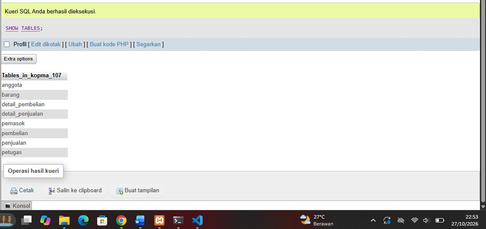
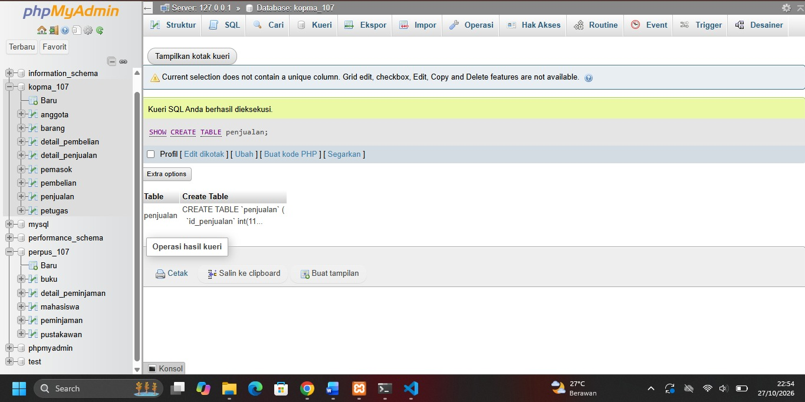
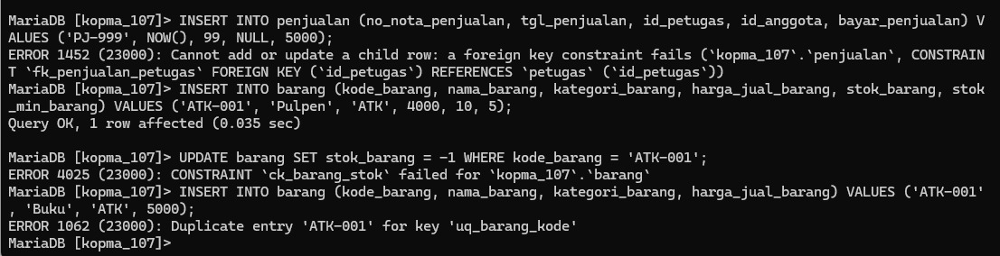
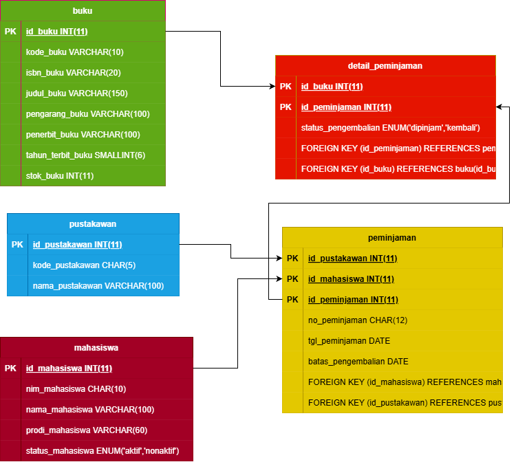

# Laporan Praktikum Basis Data - Pertemuan 05

**Nama:** Abim Faturohman  
**NPM:** 25430107  
**Kelas:** D  
**Tanggal:** 27 Oktober 2026  
**Dosen:** Dedi Irawan, S.Kom., M.T.I.  

---

## 1. Tujuan Praktikum

Tujuan pelaksanaan praktikum pada Pertemuan 5 adalah:

1. Menerjemahkan skema relasional 3NF ke dalam sintaks DDL (Data Definition Language) MariaDB.
2. Menerapkan berbagai constraint (`PRIMARY KEY`, `FOREIGN KEY`, `UNIQUE`, `NOT NULL`, `DEFAULT`, `CHECK`) sesuai aturan bisnis instansi.
3. Mengatur urutan pembuatan dan penghapusan tabel agar integritas referensial terjaga.
4. Membuktikan kekuatan constraint dalam menolak data yang melanggar aturan bisnis (uji galat).
5. Menyusun skrip DDL proyek perpustakaan yang dapat dieksekusi ulang dari basis data kosong.

## 2. Ringkasan Dasar Teori

Data Definition Language (DDL) adalah kelompok perintah SQL yang digunakan untuk mendefinisikan dan mengelola struktur objek basis data, seperti tabel, kunci, dan batasan (*constraint*). Pemilihan tipe data yang presisi sangat krusial agar alokasi memori efisien serta data yang disimpan valid secara matematis.

### 2.1 Pemetaan Kamus Data ke Tipe Data MariaDB

| Karakteristik Data | Tipe Data MariaDB | Alasan Penggunaan |
|---|---|---|
| Kode Berpanjang Tetap | `CHAR(n)` | Efisien untuk kode berformat pasti seperti NIM (`CHAR(10)`) atau Resi (`CHAR(12)`). |
| Teks Panjang Variabel | `VARCHAR(n)` | Menghemat ruang simpan untuk nama atau judul buku. |
| Nilai Moneter / Uang | `DECIMAL(p,s)` | Menghindari galat pembulatan floating point pada transaksi keuangan. |
| Angka Bulat / Kuantitas | `INT`, `SMALLINT` | Menyesuaikan jangkauan nilai maksimum item. |
| Tanggal dan Jam | `DATE`, `DATETIME` | Mendukung kalkulasi selisih hari dan audit transaksi. |
| Pilihan Terbatas | `ENUM(...)` | Membatasi isian teks hanya pada daftar nilai yang sah. |

### 2.2 Fungsi Constraint sebagai Penjaga Aturan Bisnis

Constraint memindahkan validasi aturan bisnis dari tanggung jawab pengguna/aplikasi menjadi batasan mutlak yang dijaga langsung oleh server basis data. Sejak MariaDB versi 10.2, constraint `CHECK` dieksekusi secara ketat sehingga nilai invalid langsung ditolak.

## 3. Hasil Langkah Percobaan (Kasus Kopma)

### 3.1 Eksekusi Skrip DDL Kopma
Skrip `p05_ddl_kopma_107.sql` dieksekusi pada server MariaDB 10.4.32 untuk membangun 8 tabel kanonik.


*(Catatan: Tangkapan layar dari CLI/phpMyAdmin menunjukkan 8 tabel Kopma)*

### 3.2 Struktur Tabel Utama Penjualan
Perintah `SHOW CREATE TABLE penjualan;` memperlihatkan penerapan kunci tamu `id_petugas` dan `id_anggota` yang terikat ke tabel induk.


*(Catatan: Tangkapan layar SHOW CREATE TABLE penjualan)*

### 3.3 Uji Coba Pelanggaran Constraint (Uji Negatif)
Tiga percobaan input data salah dilakukan untuk membuktikan ketahanan constraint:
1. **Pengisian Foreign Key Tak Terdaftar:** Memasukkan nota penjualan dengan `id_petugas = 99`. Ditolak dengan `ERROR 1452 (23000)`.
2. **Pengisian Stok Negatif:** Menjalankan `UPDATE barang SET stok_barang = -1`. Ditolak dengan `ERROR 4025 (23000)` dari `CONSTRAINT ck_barang_stok`.
3. **Pengisian Kode Duplikat:** Memasukkan barang baru dengan kode `ATK-001` yang sudah ada. Ditolak dengan `ERROR 1062 (23000)`.


*(Catatan: Tangkapan layar pesan galat 1452, 4025, dan 1062)*

## 4. Jawaban Titik Analisis

### 4.1 Titik Analisis 1: Aksi ON DELETE pada Kunci Tamu
`fk_detail_penjualan` menggunakan `ON DELETE CASCADE` karena rincian item nota merupakan entitas lemah yang tergantung penuh pada keberadaan header nota. Jika transaksi nota dibatalkan/dihapus, rinciannya harus otomatis terhapus. Sebaliknya, `fk_detail_barang` tidak menggunakan `CASCADE` (menggunakan perilaku bawaan `RESTRICT`) agar master data barang tidak bisa dihapus begitu saja jika sudah pernah bertransaksi. Jika master barang dihapus beserta detailnya, data riwayat transaksi lama akan rusak dan laporan omzet historis menjadi tidak valid.

### 4.2 Titik Analisis 2: Pemetaan Kode Galat ke Aturan Bisnis
* `ERROR 1452` (FK Failure) -> Menjaga integritas relasi (Petugas yang mencatat nota harus terdaftar aktif di sistem).
* `ERROR 4025` (CHECK Failed) -> Menjaga **AB-03** (Stok barang tidak boleh bernilai negatif).
* `ERROR 1062` (Duplicate Entry) -> Menjaga **AB-01/AB-05** (Nomor nota dan NIM bersifat unik).

*Aturan bisnis yang belum dijaga constraint tabel:* Aturan bahwa kuantitas penjualan tidak boleh melebihi stok yang tersedia (`qty > stok_tersedia`) serta syarat bahwa satu nota wajib memiliki minimal satu detail item barang. Batasan ini melibatkan lebih dari satu baris/tabel sehingga membutuhkan penanganan pada tingkat Transaksi Bisnis (`START TRANSACTION`) atau `TRIGGER` (Modul 14).

### 4.3 Titik Analisis 3: Urutan DROP TABLE IF EXISTS
`DROP TABLE IF EXISTS` harus dimulai dari tabel anak (`detail_penjualan`, `detail_pembelian`) sebelum tabel induk (`petugas`, `barang`). Jika tabel induk dihapus terlebih dahulu saat tabel anak masih terikat kunci tamu, MariaDB akan menolak perintah dan memunculkan galat `ERROR 1451 (23000): Cannot delete or update a parent row: a foreign key constraint fails`.

## 5. Hasil Latihan dan Modifikasi

### 5.1 Modifikasi CHECK Constraint Stok Minimum
Penambahan constraint `CHECK` untuk memastikan batas minimum stok tidak boleh bernilai negatif:
```sql
ALTER TABLE barang ADD CONSTRAINT ck_barang_stok_min CHECK (stok_min_barang >= 0);
```
Saat diuji dengan `UPDATE barang SET stok_min_barang = -5 WHERE id_barang = 1;`, perintah langsung ditolak oleh server dengan `ERROR 4025 (23000): CONSTRAINT ck_barang_stok_min failed for 'kopma_107'.'barang'`.

### 5.2 Evaluasi Aksi ON DELETE SET NULL pada Anggota
Mengubah `fk_penjualan_anggota` menjadi `ON DELETE SET NULL`:
```sql
ALTER TABLE penjualan DROP FOREIGN KEY fk_penjualan_anggota;
ALTER TABLE penjualan ADD CONSTRAINT fk_penjualan_anggota 
  FOREIGN KEY (id_anggota) REFERENCES anggota (id_anggota) ON DELETE SET NULL;
```
*Evaluasi AB-02 & UU PDP:* Kebijakan ini selaras dengan **AB-02** (penjualan boleh tanpa anggota/pembeli umum). Jika mahasiswa mengajukan penghapusan data pribadi sesuai hak hapus dalam UU Pelindungan Data Pribadi (UU PDP), profil mahasiswa di tabel `anggota` dapat dihapus tanpa membuang riwayat keuangan nota di tabel `penjualan` (kolom `id_anggota` otomatis berubah menjadi `NULL`).

## 6. Tugas Mandiri: Milestone Proyek 5

### 6.1 Implementasi DDL Proyek Perpustakaan
Skrip DDL proyek disimpan dalam berkas `p05_ddl_107.sql` untuk membangun basis data `perpus_107`. Seluruh aturan bisnis (AB-01 hingga AB-05) telah diikatkan sebagai constraint SQL.

| Tabel | Kunci Primer | Constraint Unik / CHECK | Kaitan Aturan Bisnis |
|---|---|---|---|
| `mahasiswa` | `id_mahasiswa` | `uq_mahasiswa_nim` | AB-01 (NIM Unik) |
| `buku` | `id_buku` | `uq_buku_kode`, `ck_buku_stok` | AB-02 (Kode Unik), AB-03 (Stok $\ge$ 0) |
| `pustakawan`| `id_pustakawan`| `uq_pustakawan_kode` | AB-03 (Kode Petugas Unik) |
| `peminjaman`| `id_peminjaman`| `uq_peminjaman_no`, `ck_peminjaman_tgl` | AB-04 (Resi Unik & Batas Kembali $\ge$ Tgl Pinjam) |
| `detail_peminjaman`| `(id_peminjaman, id_buku)` | FK ke `peminjaman` & `buku` | AB-05 (Item Buku Transaksi Spesifik) |

### 6.2 ERD Fisik Proyek Perpustakaan
Struktur DDL telah dicocokkan dengan ERD fisik proyek. Seluruh atribut memiliki tipe data, lebar data, dan constraint yang identik.



## 7. Pembahasan dan Kendala

**Kendala yang dialami:**  
Saat menjalankan skrip `p05_ddl_107.sql` pertama kali, terjadi galat `ERROR 1005 (HY000): Can't create table ... (errno: 150)` pada pembuatan tabel `peminjaman`.

**Solusi:**  
Setelah dilakukan penelusuran, tipe data `id_mahasiswa` pada tabel `peminjaman` sempat tertulis `SMALLINT`, sedangkan pada tabel induk `mahasiswa` bertipe `INT`. Setelah tipe data pada kunci tamu disamakan presisi dan tandanya (`INT`), skrip dapat dieksekusi dengan lancar.

## 8. Kesimpulan

Praktikum Pertemuan 5 berhasil mentransformasikan rancangan konseptual menjadi struktur fisik di MariaDB. Penggunaan constraint `PRIMARY KEY`, `FOREIGN KEY`, `UNIQUE`, dan `CHECK` secara terstruktur terbukti ampuh mencegah masuknya data cacat langsung di tingkat server. Skrip DDL yang disusun juga telah menerapkan blok `DROP TABLE IF EXISTS` dengan urutan terbalik sehingga dapat dieksekusi ulang dari basis data kosong.

## 9. Pernyataan Penggunaan AI

Asisten AI (Gemini) digunakan sekitar 20% sebagai mitra diskusi untuk memvalidasi sintaks DDL, memastikan urutan eksekusi `DROP TABLE`, serta membantu menyusun draf laporan Markdown. Seluruh eksekusi skrip SQL di terminal dan uji coba constraint dilakukan secara mandiri.

## 10. Bukti Git

| Parameter | Bukti Riwayat Eksekusi |
|---|---|
| Nama Repositori | `basisdata-107` |
| Tautan Repositori | `https://github.com/Abimfath/basisdata-25430107` |
| Pesan Commit | `p05: membuat tabel dan constraint proyek perpus` |
| Hash Commit | `[40c0b37]` |

---

## Checklist Umum Laporan

| Cek | Butir | Yang Harus Ada |
|---|---|---|
| ☑ | Identitas | Nama, NIM, kelas, pertemuan, tanggal, dosen lengkap |
| ☑ | Tujuan | Tujuan praktikum ditulis ulang dengan jelas |
| ☑ | Ringkasan Teori | Pemahaman dasar DDL dan tipe data |
| ☑ | Langkah Percobaan | Tangkapan layar langkah kunci disisipkan |
| ☑ | Titik Analisis | Semua titik analisis dijawab lengkap |
| ☑ | Latihan | Skrip hasil latihan dan penjelasan modifikasi |
| ☑ | Tugas Mandiri | Milestone proyek 5 beserta DDL dan ERD fisik |
| ☑ | Pembahasan & Kendala | Galat yang ditemui dan penanganannya |
| ☑ | Kesimpulan | Ringkasan hasil praktikum |
| ☑ | Pernyataan AI | Keterangan persentase dan fungsi penggunaan AI |
| ☑ | Bukti Git | Tautan repositori dan hash commit |

## Checklist Khusus Laporan Pertemuan 5

| Cek | Jenis | Yang Harus Ada |
|---|---|---|
| ☑ | Berkas Wajib | Berkas `p05_ddl_107.sql` dan `p05_ddl_kopma_107.sql` tersedia di repositori |
| ☑ | Bukti Tangkapan Layar | `SHOW CREATE TABLE` dan bukti galat saat constraint dilanggar |
| ☑ | Analisis Wajib | Alasan pemilihan tipe data, constraint, serta kaitan dengan AB-xx dijelaskan |