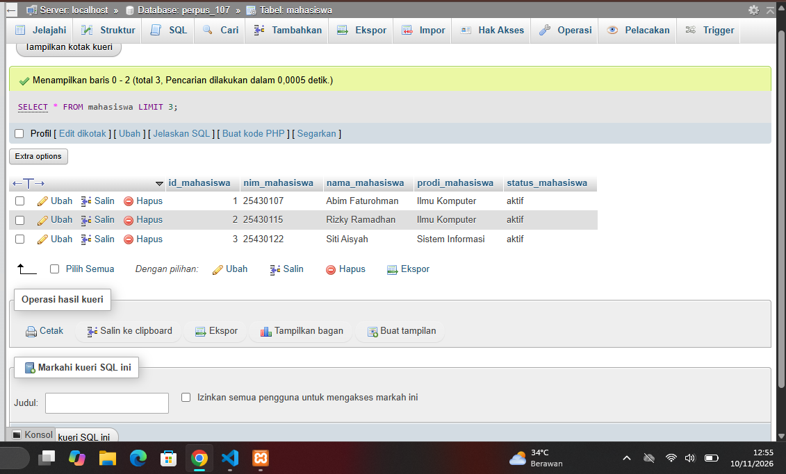
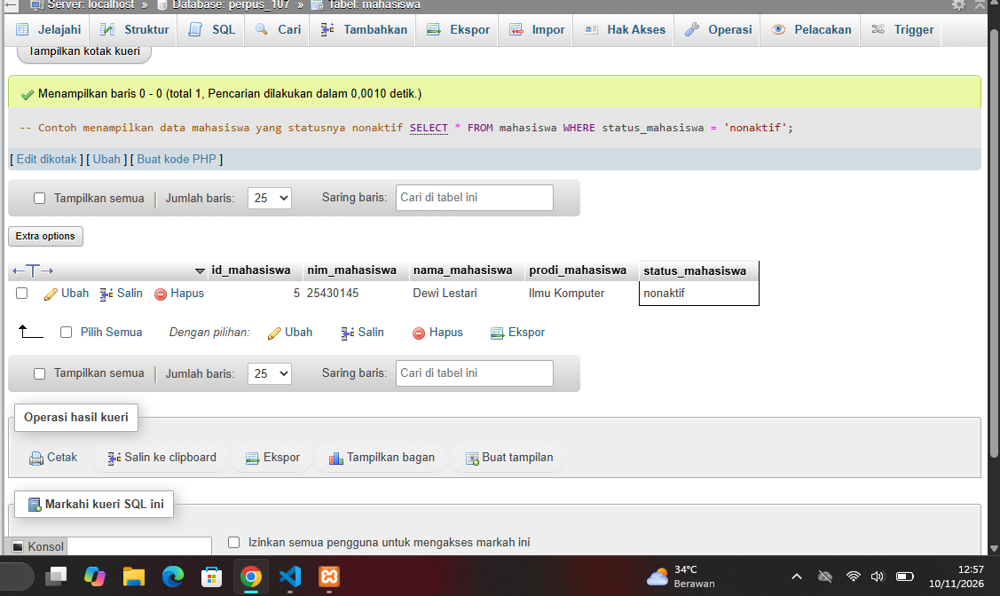
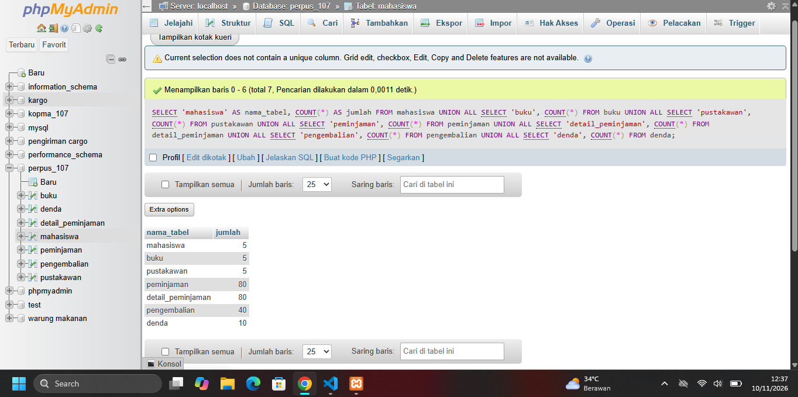
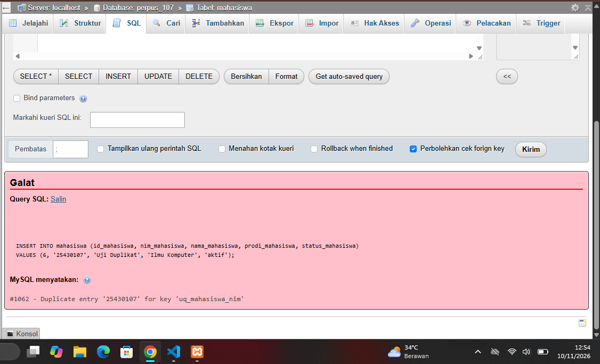

# Laporan Praktikum Modul 6 Basis Data
* **Mata Kuliah:** Praktikum Basis Data
* **Modul:** 6 - Data Manipulation Language (DML) Lanjutan & Pengujian Basis Data
* **NIM:** 25430107
* **Nama:** Abim Faturohman
* **Kelas:** D

---

## 1. Identitas & Tujuan Praktikum
1. **Identitas Basis Data:** Menggunakan basis data relasional **`perpus_107`** (Tema: Perpustakaan) dengan parameter unik proyek $P = 8$.
2. **Tujuan Praktikum:**
   * Menerapkan perintah Data Manipulation Language (DML) secara berurutan dari tabel induk ke tabel anak.
   * Melakukan manipulasi data tingkat lanjut (`INSERT`, `UPDATE`, `DELETE`) dengan memperhatikan aturan integritas referensial dan mode aman (`sql_safe_updates`).
   * Melakukan pengujian sistem basis data menggunakan skenario uji positif dan negatif untuk memvalidasi penegakan *constraint*.

---

## 2. Ringkasan Dasar Teori
Data Manipulation Language (DML) adalah sekumpulan perintah SQL yang digunakan untuk mengelola data di dalam objek basis data (tabel). Dalam praktikum ini, pengisian data wajib dilakukan secara berurutan (induk dahulu, kemudian anak) guna menghindari pelanggaran *Foreign Key* (`ERROR 1452`). Selain itu, operasi pembaruan dan penghapusan data wajib mematuhi mode aman `sql_safe_updates` untuk mencegah perubahan tak disengaja pada seluruh baris tabel tanpa klausa kunci utama yang spesifik.

---

## 3. Hasil Langkah Percobaan (D)
Bagian ini mendokumentasikan hasil uji coba perintah DML, penanganan galat mode aman (`ERROR 1175`), serta pengisian data berurutan pada skema basis data.

* **:** Menampilkan eksekusi perintah DML awal dan verifikasi mode aman `sql_safe_updates` di antarmuka phpMyAdmin / CLI.

---

## 4. Jawaban Titik Analisis 1–3
1. **Analisis 1 (`INSERT ... SELECT`):** Perintah ini memungkinkan penyalinan data secara spesifik antar tabel tanpa harus mengetik ulang nilai secara manual, sangat berguna untuk rekapitulasi atau migrasi data historis.
2. **Analisis 2 (`ON DELETE CASCADE` vs Restriksi):** Penghapusan data induk yang masih berelasi dengan tabel anak akan ditolak oleh sistem apabila tidak diatur dengan `ON DELETE CASCADE`. Hal ini krusial untuk menjaga integritas data agar rekam jejak transaksi tidak terhapus secara sepihak.
3. **Analisis 3 (Batasan `CHECK`):** Batasan `CHECK` pada tingkat baris efektif mencegah anomali data sederhana (seperti stok negatif), namun memerlukan mekanisme transaksi lanjutan (Modul 14) untuk aturan bisnis lintas tabel yang lebih kompleks.

---

## 5. Hasil Latihan & Modifikasi (E)
Modifikasi data dilakukan untuk mensimulasikan pembaruan status anggota perpustakaan yang nonaktif serta penyesuaian data buku secara aman menggunakan kolom kunci (`id_mahasiswa` / `id_buku`).

* **:** Menampilkan hasil eksekusi perintah `UPDATE` pada tabel mahasiswa dan buku.

---

## 6. Tugas Mandiri (F): Milestone Proyek 6
Berdasarkan parameter $P = 8$, struktur data `perpus_107` diisi dengan ketentuan:
* Tabel induk (`mahasiswa`, `buku`, `pustakawan`) masing-masing terisi minimal 5 baris data.
* Tabel transaksi utama (`peminjaman`) terisi **80 baris** ($10 \times 8$), yang distribusinya tersebar pada 3 tanggal berbeda (10, 12, dan 15 Oktober 2026).
* Berkas skrip DML disimpan pada `p06_data_25430107.sql` dan berkas pengujian pada `p06_uji_25430107.md`.

---

## 7. Pembahasan & Kendala
* **Kendala 1:** Sempat terjadi galat `ERROR 1175` saat melakukan `UPDATE` atau `DELETE` massal. Hal ini diselesaikan dengan memastikan klausa `WHERE` merujuk langsung pada kolom kunci utama (`id_...`).
* **Kendala 2:** Galat `ERROR 1452` teratasi dengan memastikan urutan eksekusi `INSERT` data selalu dimulai dari tabel induk (`mahasiswa`, `buku`, `pustakawan`) sebelum mengisi tabel transaksi (`peminjaman`, `detail_peminjaman`, `pengembalian`, `denda`).

---

## 8. Kesimpulan
Modul 6 berhasil diselesaikan dengan diterapkannya pengisian data DML secara konsisten, pemenuhan kuota transaksi sebanyak 80 baris, serta validasi integritas data melalui 10 skenario uji (positif dan negatif) pada basis data `perpus_107`.

---

## 9. Pernyataan Penggunaan AI
*Saya menyatakan bahwa penyusunan kueri DML, perancangan skenario uji, dan penulisan laporan ini didampingi oleh alat bantu kecerdasan buatan (AI) sebagai penasihat teknis secara etis dan bertanggung jawab.*

---

## 10. Bukti Git & Checklist Tangkapan Layar

### Daftar Tangkapan Layar yang Wajib Disertakan di Folder `laporan/img/`:
1.  — Bukti tangkapan layar eksekusi percobaan DML dan verifikasi akun/jam sistem.
2.  — Bukti tangkapan layar pembaruan data anggota/buku.
3.  — Bukti tangkapan layar eksekusi kueri `SELECT COUNT(*)` yang menunjukkan tabel terisi minimal 5 baris induk dan 80 baris transaksi.
4.  — Bukti tangkapan layar galat pengujian negatif (misalnya `ERROR 1062` atau `ERROR 1452`).

* **Tautan Repositori GitHub:** [`https://github.com/Abimfath/basisdata-25430107`](https://github.com/Abimfath/basisdata-25430107)
* **Hash Commit Terakhir:** `[abd1fba]`